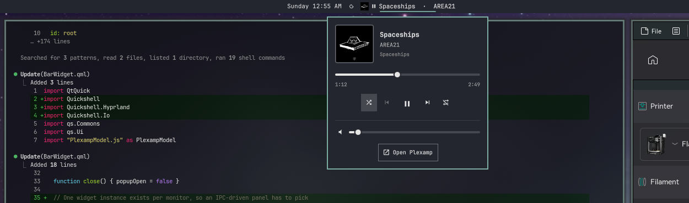

# Plexamp for Omarchy

A Plexamp widget for the [Omarchy](https://omarchy.org) shell bar: cover art and
the current track in the bar, and a player panel with a scrubbable seek bar,
transport, shuffle, repeat, and volume.

Built on MPRIS, so there is nothing to configure — no Plex token, no server URL.
Start Plexamp and the widget appears.



## Install

```bash
omarchy plugin add https://github.com/nodrej/omarchy-plexamp.git --enable --yes
```

Plugins land disabled by default so you can read the code first; drop `--enable`
if you would rather review before running it. The widget starts in the center
section and can be moved:

```bash
omarchy bar move nodrej.plexamp --section right
```

Plexamp itself comes from the AUR:

```bash
omarchy pkg aur add plexamp-appimage
```

## Remove

```bash
omarchy plugin remove nodrej.plexamp
```

That deletes `~/.config/omarchy/plugins/nodrej.plexamp/` and the widget's bar
entry. The plugin keeps no state anywhere else: its settings live inline on
that entry in `~/.config/omarchy/shell.json`, which the same command clears.
To keep it installed but off the bar, `omarchy plugin disable nodrej.plexamp`.

## What you get

**In the bar** — cover art, a play/pause glyph, and a marquee of
`title · artist`. On a vertical bar it collapses to art plus play state.

| Interaction | Action |
|---|---|
| Left click | Open the player panel (configurable) |
| Right click | Play / pause |
| Middle click | Next track |
| Scroll | Previous / next track, or volume |
| Hover | Tooltip with title, artist, album |

**In the panel** — large cover, title/artist/album, a seek bar you can drag
(it commits on release, so scrubbing never stutters Plexamp), elapsed and total
time, shuffle, previous, play/pause, next, repeat, a volume slider, and an
_Open Plexamp_ button. When Plexamp is not running the panel becomes a launcher.

Controls follow what Plexamp actually reports over MPRIS: buttons dim when the
player says it cannot do the thing, so repeat and shuffle never lie about state.

## Settings

Settings live inline on the widget's entry in `~/.config/omarchy/shell.json`:

```json
{
  "id": "nodrej.plexamp",
  "showArt": true,
  "showLabel": true,
  "labelMode": "scroll",
  "labelWidth": 180,
  "visibility": "when-running",
  "leftClick": "panel",
  "wheelAction": "track",
  "seekStep": 10,
  "launchCommand": "plexamp.desktop"
}
```

| Key | Values | Default | What it does |
|---|---|---|---|
| `showArt` | bool | `true` | Cover art thumbnail in the bar |
| `showLabel` | bool | `true` | Track label next to the play glyph |
| `showProgress` | bool | `true` | Hairline playback progress under the chip |
| `labelMode` | `full`, `scroll`, `truncate` | `scroll` | How a track label wider than `labelWidth` is handled. `full` ignores the limit and lets the chip grow — good on an ultrawide, where nothing needs to move |
| `labelWidth` | 60–600 | `180` | Max label width in px. Ignored when `labelMode` is `full` |
| `labelFormat` | template | `{title}  ·  {artist}` | Placeholders `{title}`, `{artist}`, `{album}`. A separator stranded by an empty field is dropped, so a track with no artist reads cleanly |
| `scrollLabel` | bool | `true` | Legacy. Only consulted when `labelMode` is unset: `true` → `scroll`, `false` → `truncate` |
| `monitorMode` | `all`, `focused`, `named` | `all` | A bar exists per monitor, so the chip appears on all of them by default |
| `monitors` | array | `[]` | Monitor names for `monitorMode: named`, e.g. `["DP-1","DP-3"]`. An empty list shows everywhere |
| `middleClick` | `next`, `previous`, `playPause`, `panel`, `none` | `next` | Middle click behaviour |
| `visibility` | `when-running`, `when-playing`, `always` | `when-running` | When the chip shows. `always` turns it into a launcher while Plexamp is closed |
| `leftClick` | `panel`, `playPause` | `panel` | What left click does; right click takes the other one |
| `wheelAction` | `track`, `volume`, `none` | `track` | Scroll wheel behaviour |
| `seekStep` | 5–120 | `10` | Seconds per `seekForward` / `seekBack` |
| `launchCommand` | string | `plexamp.desktop` | Command or `.desktop` id used to start Plexamp |

## Keybindings

Everything is reachable through one IPC target. Bind it in
`~/.config/hypr/bindings.lua`:

```lua
o.bind("SUPER", "M", "exec", "omarchy-shell plexamp togglePanel")
o.bind("SUPER SHIFT", "space", "exec", "omarchy-shell plexamp playPause")
o.bind("SUPER SHIFT", "right", "exec", "omarchy-shell plexamp next")
o.bind("SUPER SHIFT", "left", "exec", "omarchy-shell plexamp previous")
```

| Method | Effect |
|---|---|
| `status` | JSON: track, position, length, shuffle, repeat, volume, capabilities |
| `playPause`, `play`, `pause` | Transport |
| `next`, `previous` | Track change |
| `seekForward`, `seekBack` | Seek by `seekStep` seconds |
| `shuffle` | Toggle shuffle |
| `repeat` | Cycle off → queue → track |
| `volumeUp`, `volumeDown` | ±5% |
| `togglePanel`, `showPanel`, `hidePanel` | The player popup |
| `raise` | Focus the Plexamp window, launching it if needed |
| `launch` | Start Plexamp |
| `ping` | Health check |

The panel opens on the focused monitor and closes on the others, so a
keybinding does the right thing on a multi-monitor setup.

`status` makes the plugin scriptable from anywhere:

```bash
omarchy-shell plexamp status | jq -r '"\(.title) — \(.artist)"'
```

## How it works

| File | Role |
|---|---|
| `Service.qml` | MPRIS binding, position tracking, playback actions, all IPC |
| `BarWidget.qml` | The bar chip, mouse handling, per-monitor panel state |
| `PlexampPanel.qml` | Popup contents |
| `PlexampModel.js` | Pure helpers: player matching, time formatting, glyph choice |

The service is mounted once per session while the bar widget exists per monitor,
so every screen shows identical state and the IPC surface has a single owner.

MPRIS reports position only on request, so the service samples it, interpolates
between samples while playing, and re-syncs every three seconds — the seek bar
advances smoothly and still catches seeks made inside Plexamp. Timers stop
entirely when playback is paused or Plexamp is closed.

## Hacking on it

```bash
git clone https://github.com/nodrej/omarchy-plexamp.git ~/.config/omarchy/plugins/nodrej.plexamp
omarchy-shell shell rescanPlugins
omarchy plugin enable nodrej.plexamp
```

Saving any file under `~/.config/omarchy/plugins/` hot-reloads the plugin code.
One exception: adding or renaming an `IpcHandler` target needs a full
`omarchy restart shell` before the new target answers.

Validate the manifest before pushing:

```bash
omarchy plugin validate ~/.config/omarchy/plugins/nodrej.plexamp
```

Plugins run unsandboxed inside `omarchy-shell`. This one talks to MPRIS over
D-Bus, runs `omarchy-launch-or-focus` when you ask it to start Plexamp, and
runs `omarchy bar set` when you change something in the settings view — that
is the only way it writes config, and it only ever touches its own entry in
`shell.json`. It makes no network calls and reads no Plex credentials.

## Compatibility

Omarchy 4.x (shell plugin schema v1), Quickshell 0.3+, Plexamp 4.x desktop
(AppImage, Flatpak, and system builds all export the same MPRIS interface).
Headless Plexamp has no MPRIS surface and is not supported.

## License

MIT
